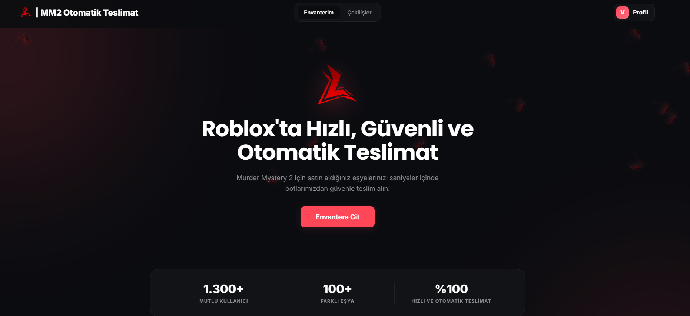
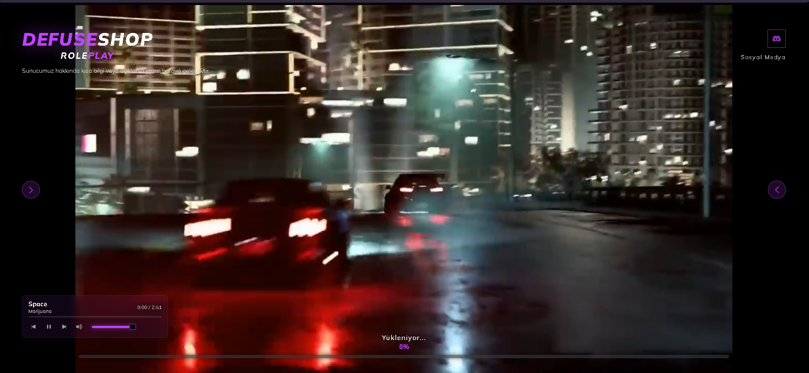

  <h1>Merhaba, Ben Zeix (Bydefuse) 👋</h1>
  <h3>Full-Stack Developer • Otomasyon & Bot Mimarı • Sistem Geliştiricisi</h3>
  

    E-ticaret otomasyonları, otonom oyun içi teslimat sistemleri, yüksek performanslı CLI araçları ve modern web arayüzleri geliştiren çok yönlü bir yazılımcıyım. Tekrarlayan iş süreçlerini uçtan uca otonom hale getiren, ölçeklenebilir ve güvenli sistemler tasarlıyorum.
  

  

    
    
    
  

---

### 📊 Geliştirici Performans & Proje Metrikleri

| Metrik | Değer | Açıklama |
| :--- | :---: | :--- |
| 🚀 **Tamamlanan Proje** | **15+** | Başarıyla yayına alınmış anahtar teslim sistem |
| ⏱️ **Ort. Proje Süresi** | **3 - 7 Gün** | Proje karmaşıklığına göre hızlı ve optimize teslim |
| 🎯 **Sistem Başarı Oranı** | **%99.8** | Otonom botlarda kesintisiz ve hatasız çalışma |
| 🔄 **Aktif Geliştirme** | **5 Devam Eden** | Sırada bekleyen yeni nesil otomasyon projeleri |

---

### 🎚️ Proje Zorluk Dereceleri & Uzmanlık Dağılımı

* **🟢 Düşük / Orta Zorluk (Frontend & Arayüzler):** 
  * *Örnekler:* FiveM Loading Screen, Statik/Dinamik Tanıtım Sayfaları.
  * *Teknolojiler:* HTML5, CSS3, JavaScript, LUA.
* **🟡 Yüksek Zorluk (Web Panelleri & Entegrasyonlar):** 
  * *Örnekler:* Growtopia & MM2 Otomatik Teslimat Sistemleri, Web Yönetim Panelleri.
  * *Teknolojiler:* Node.js, PHP, REST API Entegrasyonları, Güvenli Veritabanı Mimarisi.
* **🔴 İleri Düzey / Uzmanlık (Otonom Botlar & CLI Altyapıları):** 
  * *Örnekler:* DCTG (Discord Enterprise Bot), Çoklu Hesap Üretim Otomasyonları.
  * *Teknolojiler:* Python, Multi-Threading, Captcha Çözücü Entegrasyonları, Proxy/VPN İzolasyonu.

---

### 🛠️ Teknoloji Yığını & Yetenekler

  
  
  
  
  
  
  

---

### 🚀 Öne Çıkan Tamamlanmış Projeler

#### 1. Growtopia Auto Delivery Bot & Web Panel [Zorluk: 🟡 İleri]
Growtopia oyun içi eşya ticaretini tamamen otonom hale getiren uçtan uca teslimat ve yönetim platformudur.
* **Çalışma Mantığı:** Kullanıcı web paneline teslimat kodunu girer; sistem arka plandaki oyun içi botla haberleşerek eşyayı güvenli takas penceresiyle saniyeler içinde teslim eder.
* **Teknolojiler:** `Node.js`, `JavaScript`, `HTML5`, `CSS3`, `PHP`

  

 

#### 2. Murder Mystery 2 (Roblox) Automatic Delivery [Zorluk: 🟡 İleri]
Roblox MM2 oyunu için geliştirilmiş, 1.300+ aktif kullanıcılı otomatik eşya teslimat ve envanter sistemidir.
* **Çalışma Mantığı:** Envantere tanımlanan eşyaların talebe göre otonom sunucu botlarıyla hatasız ve anlık transferini sağlar.
* **Teknolojiler:** `Python`, `Node.js`, `JavaScript`, `HTML5`, `CSS3`

  

 

#### 3. DCTG — Discord Enterprise Account & Token Generator [Zorluk: 🔴 Uzman]
Yüksek ölçekli otomasyon ve hesap yönetimi için geliştirilmiş CLI tabanlı gelişmiş suite yazılımıdır.
* **Çalışma Mantığı:** Mullvad VPN ile IP izolasyonu sağlar, 9Captcha entegrasyonuyla doğrulamaları otonom geçer ve insan davranışını taklit eder.
* **Teknolojiler:** `Python`, `CLI Architecture`, `API Integration`

  

 

#### 4. FiveM Roleplay Custom Loading Screen [Zorluk: 🟢 Orta]
FiveM sunucuları için tasarlanmış modern, müzik çalarlı ve interaktif yükleme arayüzüdür.
* **Teknolojiler:** `LUA`, `HTML5`, `CSS3`, `JavaScript`

  

---

### ⏳ Aktif Geliştirme Sürecindeki Projeler (WIP)

Şu an üzerinde çalıştığım, optimizasyon ve test aşamasında olan yeni nesil projelerim:

* **🔄 Automatic Gmail Account Generator (CLI):** Tarayıcı parmak izi ve proxy rotasyonu destekli otonom Gmail hesap üretim otomasyonu.
* **🔄 Microsoft Hotmail & Outlook Generators:** Yüksek hacimli e-posta altyapısı gereksinimleri için Captcha entegrasyonlu botlar.
* **🔄 Yahoo Mail Account Generator:** Özel istek yapılarıyla çalışan otomatik Yahoo hesap oluşturma yazılımı.
* **🔄 OwO Cash Automation Bot:** Discord OwO ekonomisi için güvenlik korumalı ve akıllı gecikme algoritmalı bakiye kasma botu.

---

### 📫 İletişim

* **Discord:** `Bydefuse`
* **GitHub:** [@bydefuse](https://github.com/bydefuse)
