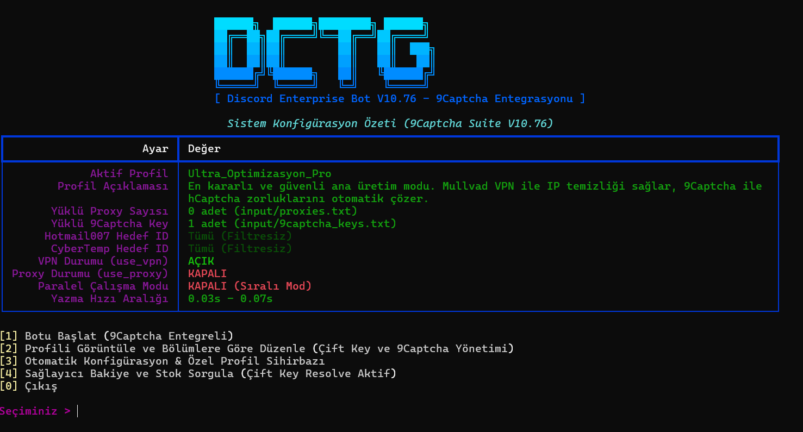

  <h1>Merhaba, Ben Zeix (Bydefuse) 👋</h1>
  <h3>Full-Stack Developer • Otomasyon & Bot Geliştiricisi • Sistem Mimarı</h3>
  

    E-ticaret otomasyonları, oyun içi otonom teslimat sistemleri, yüksek performanslı CLI araçları ve modern web arayüzleri geliştiren çok yönlü bir yazılım geliştiricisiyim. Karmaşık ve tekrarlayan iş süreçlerini uçtan uca otonom hale getiren, ölçeklenebilir ve kullanıcı dostu çözümler üretiyorum.
  

  

    
    
  

---

### 🛠️ Teknoloji Yığını & Uzmanlık Alanları

Tüm modern yazılım dilleri ve mimarileriyle aktif olarak çalışmakla birlikte, projelerimde ağırlıklı olarak aşağıdaki teknolojileri kullanıyorum:

* **Backend & Otomasyon:** `Python` • `Node.js` • `PHP` • `LUA`
* **Frontend & Arayüz Tasarımı:** `JavaScript (ES6+)` • `HTML5` • `CSS3` • `Modern UI/UX`
* **Sistem & Bot Mimarisi:** `Otonom Oyun Botları` • `API & Webhook Entegrasyonları` • `Multi-Thread CLI Araçları` • `Otomatik Teslimat Sistemleri`

  
  
  
  
  
  
  

---

### 🚀 Öne Çıkan Tamamlanmış Projeler

#### 1. Growtopia Auto Delivery Bot & Otomatik Kod Teslimat Ekosistemi
Growtopia oyun içi eşya (BGL, DL vb.) ticaretini tamamen otonom hale getiren uçtan uca teslimat ve yönetim platformudur.
* **Nasıl Çalışır?:** Kullanıcılar web arayüzü üzerinden kendilerine tanımlanan teslimat kodunu girdiklerinde, sistem arka plandaki oyun içi botlarla anlık haberleşir. Bot, belirtilen dünyaya (world) giriş yaparak eşyayı yere atma riski olmadan güvenli takas (trade) penceresi üzerinden saniyeler içinde teslim eder.
* **Öne Çıkan Özellikler:** 7/24 aktif otonom takas botu, kod doğrulama ve stok yönetim paneli, canlı sipariş takibi ve tam entegre web kontrol merkezi.
* **Teknolojiler:** `Node.js`, `JavaScript`, `HTML5`, `CSS3`, `PHP`

  

 

#### 2. Murder Mystery 2 (Roblox) Automatic Delivery System
Roblox platformundaki Murder Mystery 2 oyunu için geliştirilmiş tam otomatik eşya teslimat ve envanter yönetim sistemidir.
* **Nasıl Çalışır?:** Müşterilerin satın aldığı oyun içi eşyalar web platformundaki envanterlerine tanımlanır. Kullanıcı "Envantere Git" üzerinden teslimat talebi başlattığında, arka plandaki otomasyon botu sunucuya bağlanarak ilgili kullanıcıya eşyalarını otomatik olarak aktarır.
* **Öne Çıkan Özellikler:** 1.300+ aktif kullanıcı altyapısı, 100+ farklı eşya kataloğu desteği, çekiliş modülü ve saniyeler içinde gerçekleşen sıfır hatalı teslimat süreci.
* **Teknolojiler:** `Python`, `Node.js`, `JavaScript`, `HTML5`, `CSS3`

  

 

#### 3. DCTG — Discord Enterprise Account & Token Generator Suite
Yüksek ölçekli hesap oluşturma ve otomasyon operasyonları için tasarlanmış, gelişmiş konfigürasyon ve ağ yönetimine sahip CLI tabanlı otomasyon yazılımıdır.
* **Nasıl Çalışır?:** Modüler profil yapısı sayesinde proxy veya VPN (Mullvad VPN entegrasyonu) üzerinden IP izolasyonu sağlar. Entegre Captcha çözücü servisleri (9Captcha vb.) ile doğrulama adımlarını otonom olarak geçer ve insan davranışını taklit eden yazma hızı algoritmalarıyla hesap/token üretimini gerçekleştirir.
* **Öne Çıkan Özellikler:** Çoklu profil yönetimi, otomatik konfigürasyon sihirbazı, paralel ve sıralı çalışma modları, anlık bakiye/stok sorgulama ekranı.
* **Teknolojiler:** `Python`, `CLI Architecture`, `API Integration`

  

 

#### 4. FiveM Roleplay Custom Loading Screen
FiveM sunucularına bağlanan oyunculara modern, akıcı ve etkileşimli bir karşılama deneyimi sunan özel yükleme ekranı arayüzüdür.
* **Nasıl Çalışır?:** Sunucu kaynakları yüklenirken oyunculara anlık yükleme yüzdesini gösterir; arka planda özel medya oynatıcısı, sunucu tanıtım metinleri ve sosyal medya yönlendirmeleriyle bekleme süresini keyifli hale getirir.
* **Öne Çıkan Özellikler:** Entegre müzik çalar (ses kontrolü ve parça geçişi), dinamik arka plan görselleri/videoları, özelleştirilebilir sunucu duyuru alanı ve düşük kaynak tüketimi.
* **Teknolojiler:** `LUA`, `HTML5`, `CSS3`, `JavaScript`

  

---

### ⚙️ Aktif Geliştirme Sürecindeki Projeler (WIP)

Şu anda mimari optimizasyonları ve test süreçleri devam eden, yakında yayına alınacak otomasyon projelerim:

* **🔄 Automatic Gmail Account Generator (CLI):** Komut satırı arayüzü (CLI) üzerinden çalışan, tarayıcı parmak izi (fingerprint) ve proxy rotasyonu destekli tam otomatik Gmail hesap oluşturma otomasyonu. *(Aktif Geliştirme Sürecinde)*
* **🔄 Microsoft Hotmail & Outlook Account Generators:** Yüksek hacimli e-posta altyapısı ihtiyaçları için geliştirilen, Captcha çözücü entegrasyonlu otonom Hotmail ve Outlook hesap üretim botları. *(Aktif Geliştirme Sürecinde)*
* **🔄 Yahoo Mail Account Generator:** Özelleştirilmiş istek yapılarıyla çalışan otomatik Yahoo Mail oluşturucu yazılımı. *(Aktif Geliştirme Sürecinde)*
* **🔄 OwO Cash Automation Bot:** Discord üzerindeki OwO ekonomisi için insan benzeri gecikme algoritmaları ve güvenlik önlemleriyle donatılmış otomatik bakiye kasma botu. *(Aktif Geliştirme Sürecinde)*

---

### 📫 İletişim & İş Birliği

Özel yazılım geliştirme, otomasyon sistemleri, web panelleri ve bot projeleri için benimle doğrudan iletişime geçebilirsiniz:

* **Discord:** `Bydefuse`
* **GitHub:** [@bydefuse](https://github.com/bydefuse)
