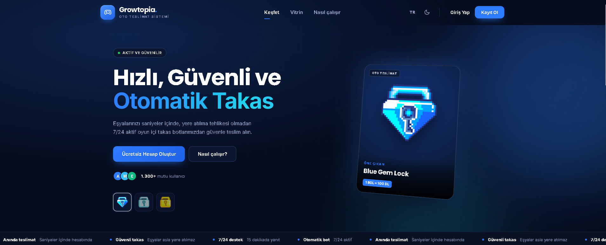

  
  <h1>✨ Merhaba, Ben Zeix (Bydefuse) 👋</h1>
  <h3>Full-Stack Developer • Automation Architect • Bot Systems Specialist</h3>
  
  

    
    
    
  

---

> **Yazılımcı Notu:** Kod yazarken sadece "çalışmasına" değil; ölçeklenebilirliğine, güvenlik katmanlarına (Proxy/VPN izolasyonu, Captcha bypass) ve mimari temizliğine odaklanırım. Amacım, manuel ve tekrara dayanan tüm iş süreçlerini tamamen otonom hale getiren kusursuz sistemler inşa etmektir.

---

### 📈 Geliştirici Performans ve Analitik Göstergeleri

| Metrik | Durum / Değer | Teknik Açıklama |
| :--- | :---: | :--- |
| 🚀 **Tamamlanan Sistem** | **15+ Adet** | Uçtan uca test edilmiş, canlıda çalışan anahtar teslim projeler |
| ⏱️ **Ortalama Teslimat** | **3 - 7 Gün** | Proje karmaşıklığına göre optimize edilmiş hızlı geliştirme döngüsü |
| 🛡️ **Sistem Kararlılığı** | **%99.8** | Otonom botlarda kesintisiz, ban ve hata riskinden arındırılmış altyapı |
| 🔄 **Aktif Geliştirme (WIP)** | **5 Proje** | Şu an üzerinde çalışılan yeni nesil otomasyon ve generator yazılımları |

---

### 🎯 Uzmanlık Alanları ve Mimari Zorluk Dereceleri

* **🟢 Seviye 1: Arayüz ve Ön Yüz Geliştirme (Orta Zorluk)**
  * *Faaliyet Alanı:* Dinamik web sunucu arayüzleri, FiveM özel yükleme ekranları.
  * *Kullanılan Teknolojiler:* `HTML5`, `CSS3`, `JavaScript (ES6+)`, `LUA`.
* **🟡 Seviye 2: Tam Entegre E-Ticaret & Teslimat Sistemleri (İleri Düzey)**
  * *Faaliyet Alanı:* Web panelleri ile oyun içi otonom botlar arasındaki anlık haberleşme (API / WebSocket / Veritabanı senkronizasyonu).
  * *Kullanılan Teknolojiler:* `Node.js`, `PHP`, `JavaScript`, `RESTful API`.
* **🔴 Seviye 3: Otonom Botlar & CLI Otomasyon Altyapıları (Uzmanlık / Master)**
  * *Faaliyet Alanı:* Çoklu thread (Multi-threading) desteği, proxy rotasyonu, parmak izi maskeleme ve Captcha çözücü entegrasyonları ile çalışan devasa otomasyon suitleri.
  * *Kullanılan Teknolojiler:* `Python`, `CLI Architecture`, `External API Integration`.

---

### 🛠️ Teknoloji Yığını (Tech Stack)

  
  
  
  
  
  
  

---

### 🚀 Öne Çıkan Tamamlanmış Projeler

#### 1. Growtopia Oto Teslimat Sistemi & Web Panel *(Zorluk: 🟡 İleri Düzey)*
* **Proje Kapsamı ve Mimari:** Growtopia oyun içi ekonomisinde yüksek hacimli eşya (BGL, DL vb.) ticaretini tamamen otonom hale getiren kurumsal bir e-ticaret ve teslimat ekosistemidir. 
* **Çalışma Akışı:** Kullanıcı e-ticaret platformundan veya web panelinden alışveriş yaptığında sisteme benzersiz bir teslimat kodu üretilir. Kullanıcı bu kodu web arayüzüne girdiğinde, arka planda 7/24 kesintisiz çalışan Node.js tabanlı oyun içi bot tetiklenir. Bot, hedef dünyaya (`world`) otonom olarak bağlanır; eşyanın yere atılmasından kaynaklı kayıp veya dolandırıcılık riskini tamamen ortadan kaldıran güvenli takas (`trade`) penceresi üzerinden saniyeler içinde teslimatı tamamlar.
* **Mühendislik Detayları:** Veritabanı senkronizasyonu, anlık stok takibi, webhook bildirimleri ve hata toleranslı (fault-tolerant) yeniden bağlanma mekanizmalarıyla donatılmıştır.
* **Tech Stack:** `Node.js`, `JavaScript`, `HTML5`, `CSS3`, `PHP`

  

 

#### 2. Murder Mystery 2 (Roblox) Automatic Delivery *(Zorluk: 🟡 İleri Düzey)*
* **Proje Kapsamı ve Mimari:** Roblox platformunun en popüler oyunlarından biri olan Murder Mystery 2 (MM2) için geliştirilmiş, kullanıcının siparişlerini yöneten otonom eşya dağıtım ve envanter yönetim platformudur.
* **Çalışma Akışı:** Oyuncular satın aldıkları envanter öğelerini web paneli üzerinden yönetirler. Teslimat talebi oluşturulduğu anda sistem, kuyruk mantığıyla (Queue System) çalışan arka plan botlarını görevlendirir. Bot, ilgili sunucuya sızarak eşyayı alıcıya hatasız ve gecikmesiz bir şekilde aktarır. Sistem aynı zamanda platform içi çekiliş modülleri ve dinamik stok raporlama araçlarıyla tam entegre çalışır.
* **Mühendislik Detayları:** Yüksek trafik altında çökmeyen asenkron istek yönetimi, kullanıcı yetkilendirme katmanları ve loglama mekanizması.
* **Tech Stack:** `Python`, `Node.js`, `JavaScript`, `HTML5`, `CSS3`

  

 

#### 3. DCTG — Discord Enterprise Account & Token Generator *(Zorluk: 🔴 Uzman)*
* **Proje Kapsamı ve Mimari:** Yüksek ölçekli hesap operasyonları ve kurumsal otomasyon ihtiyaçları için sıfırdan tasarlanmış, gelişmiş konfigürasyon ve ağ yönetimine sahip CLI (Komut Satırı) tabanlı otomasyon suitidir.
* **Çalışma Akışı:** Sistem; Mullvad VPN entegrasyonu sayesinde her işlemde IP izolasyonu ve temizliği sağlar. Karşılaşılan bot korumalarını ve doğrulama duvarlarını aşmak için 9Captcha API servislerini dinamik olarak tetikler. İnsan davranışını birebir taklit eden, rastgele gecikme sürelerine (human-like typing delay) sahip yazma algoritmalarıyla hesap ve token üretim süreçlerini otonom olarak yönetir.
* **Mühendislik Detayları:** Multi-threading (Çoklu iş parçacığı) desteği, modüler profil yönetimi, otomatik hata yakalama ve anlık bakiye/stok sorgulama konsolu.
* **Tech Stack:** `Python`, `CLI Architecture`, `Threading`, `API Integration`

  

 

#### 4. FiveM Roleplay Custom Loading Screen *(Zorluk: 🟢 Orta Seviye)*
* **Proje Kapsamı ve Mimari:** FiveM roleplay sunucularına bağlanan oyunculara akıcı, modern ve etkileşimli bir karşılama deneyimi sunan özel web tabanlı yükleme arayüzüdür.
* **Çalışma Akışı:** Oyuncu sunucu dosyalarını indirip yüklerken arayüz, arka planda optimize edilmiş dinamik video akışı veya görseller sunar. Entegre müzik çalar (ses açma/kapama ve parça değiştirme özellikleri ile) oyuncunun bekleme süresini keyifli hale getirir. Sunucu kuralları, sosyal medya bağlantıları ve yönetim kadrosu bilgileri arayüz üzerinden dinamik olarak güncellenir.
* **Mühendislik Detayları:** Düşük kaynak tüketimi (low resource overhead), optimize edilmiş DOM manipülasyonu ve akıcı CSS animasyonları.
* **Tech Stack:** `LUA`, `HTML5`, `CSS3`, `JavaScript`

  

---

### ⏳ Aktif Geliştirme Sürecindeki Projeler (WIP State)

Şu an üzerinde aktif olarak kod yazdığım, mimari testleri ve optimizasyon süreçleri devam eden yeni nesil projelerim:

* **🔄 Automatic Gmail Account Generator (CLI):** Tarayıcı parmak izi (browser fingerprinting) simülasyonu, çerez yönetimi ve proxy havuzu rotasyonu ile tamamen otonom çalışan kurumsal Gmail hesap üretim aracı.
* **🔄 Microsoft Hotmail & Outlook Account Generators:** Yüksek hacimli e-posta otomasyon gereksinimleri için geliştirilen, Captcha çözücü entegreli ve ban korumalı otonom e-posta üretim botları.
* **🔄 Yahoo Mail Account Generator:** Ham socket istekleri ve optimize edilmiş HTTP header yapılarıyla saniyeler içinde binlerce hesap üretebilen yüksek performanslı Yahoo otomasyonu.
* **🔄 OwO Cash Automation Bot:** Discord üzerindeki OwO ekonomi botu için geliştirilen; yapay zeka tabanlı akıllı gecikme algoritmaları, anti-ban güvenlik katmanları ve kesintisiz çalışma mantığına sahip bakiye kasma otomasyonu.

---

### 📫 İletişim & Profesyonel Ağ

Özel otomasyon sistemleri, web panelleri veya bot projeleri için benimle iletişime geçebilirsiniz:

* **Discord:** `Bydefuse`
* **GitHub:** [@bydefuse](https://github.com/bydefuse)
